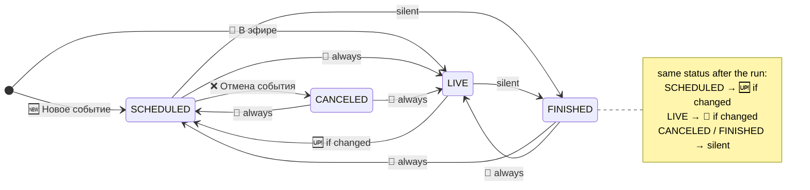

# event-notifications Specification

## Purpose

Defines which event lifecycle transitions notify Telegram subscribers, and the header and content of each notification, so that subscribers learn about new, changed, live, canceled and returning events exactly once and are not told about events that ended normally.

## Overview

Informative map of the notification sent on each status transition defined in `event-lifecycle`; the requirements and scenarios below are normative. "always" means even if no field changed; "if changed" means only if at least one field changed; "silent" means no notification.

Not shown: nothing is sent when status and fields are unchanged; at most one notification per event per run; every notification goes to every registered user, and nothing is sent without a bot token.

## Requirements

### Requirement: Recipients
Every notification SHALL be sent to every registered Telegram user, as a photo message with the event image. If no user is registered, processing SHALL still run and save events as usual, and nothing is sent. A user who registers later SHALL NOT be notified about events already stored.

#### Scenario: Several users
- **WHEN** two users are registered and one event produces a notification
- **THEN** each user receives that notification once

#### Scenario: No users
- **WHEN** no user is registered and a new event appears on the site
- **THEN** the run saves the event and sends nothing

#### Scenario: User registers after events were stored
- **WHEN** an event was saved while no user was registered, a user then registers, and the event is unchanged on the next run
- **THEN** the user receives no notification for it

### Requirement: Telegram is optional
The application SHALL start and process events without Telegram credentials. With no bot token configured, the bot SHALL NOT be registered and no message SHALL be sent, while scraping, saving and the calendar export work as usual. The application SHALL log a warning at startup that Telegram is disabled.

#### Scenario: No bot token
- **WHEN** the application starts without a bot token and a new event appears on the site
- **THEN** the event is saved, the calendar file is updated if export is enabled, and no Telegram message is sent

#### Scenario: Registered users without a bot token
- **WHEN** users are registered but no bot token is configured and an event produces a notification
- **THEN** no Telegram message is sent and no sending error is logged

### Requirement: New event notification
A new event SHALL notify with the full card: "🆕 Новое событие" if it is not live, "🔴 В эфире" if it is live.

#### Scenario: New scheduled event
- **WHEN** a new event appears on the site, not live
- **THEN** subscribers receive "🆕 Новое событие" with the full card

#### Scenario: New live event
- **WHEN** a new event appears on the site already live
- **THEN** subscribers receive "🔴 В эфире" with the full card

### Requirement: Update notification
An event that is SCHEDULED after the run and was SCHEDULED or LIVE before SHALL notify with "🆙 Обновление события" and the card with diff if at least one field changed, including the participants list, and SHALL NOT notify if only the status changed.

#### Scenario: Scheduled event changed
- **WHEN** a SCHEDULED event is on the site with a changed date and stays SCHEDULED
- **THEN** subscribers receive "🆙 Обновление события" showing the date as old → new

#### Scenario: Scheduled event participants changed
- **WHEN** a SCHEDULED event is on the site, stays SCHEDULED, and only its participants changed from "Андрей Маковеев, Дмитрий Карнов" to "Андрей Маковеев"
- **THEN** subscribers receive "🆙 Обновление события" with the line `🧑‍🧒‍🧒 Андрей Маковеев, Дмитрий Карнов → Андрей Маковеев`

#### Scenario: Live event shown as not live with changes
- **WHEN** a LIVE event is on the site, no longer live, and its name changed
- **THEN** subscribers receive "🆙 Обновление события" showing the name change

#### Scenario: Live event shown as not live without changes
- **WHEN** a LIVE event is on the site, no longer live, and none of its fields changed
- **THEN** the event is saved as SCHEDULED and no notification is sent

### Requirement: Live notification
An existing event SHALL notify with "🔴 В эфире" and the card with diff when it enters LIVE from any other status, even if no field changed, and when it stays LIVE and at least one field changed.

#### Scenario: Scheduled event goes live without other changes
- **WHEN** a SCHEDULED event goes live and none of its fields changed
- **THEN** subscribers receive "🔴 В эфире" with the card

#### Scenario: Live event changed
- **WHEN** a LIVE event stays live and its description changes
- **THEN** subscribers receive "🔴 В эфире" showing the description change

#### Scenario: Canceled event returns live
- **WHEN** a CANCELED event is on the site again and is live
- **THEN** subscribers receive "🔴 В эфире" with the card

#### Scenario: Finished event returns live
- **WHEN** a FINISHED event is on the site again and is live
- **THEN** subscribers receive "🔴 В эфире" with the card

### Requirement: Cancellation notification
A SCHEDULED event that becomes CANCELED SHALL notify with "❌ Отмена события" and the card built from the stored values.

#### Scenario: Scheduled event canceled
- **WHEN** a SCHEDULED event becomes CANCELED
- **THEN** subscribers receive "❌ Отмена события" with the stored name, date, participants and description

#### Scenario: Canceled event without participants
- **WHEN** a SCHEDULED event with no stored participants becomes CANCELED
- **THEN** the "❌ Отмена события" card has no participants line

### Requirement: Return notification
A CANCELED or FINISHED event that is on the site again and not live SHALL notify with "🔁 Снова в расписании" and the card with diff, even if no field changed.

#### Scenario: Canceled event returns unchanged
- **WHEN** a CANCELED event is on the site again, not live, with the same fields as stored
- **THEN** subscribers receive "🔁 Снова в расписании" with the card

#### Scenario: Finished event returns with a new date
- **WHEN** a FINISHED event is on the site again, not live, with a new date
- **THEN** subscribers receive "🔁 Снова в расписании" showing the date as old → new

### Requirement: Silent endings
An event that becomes FINISHED SHALL NOT produce a notification, whether it was LIVE or SCHEDULED before. Each run SHALL send at most one notification per event.

#### Scenario: Stream ends
- **WHEN** a LIVE event disappears from the site
- **THEN** no notification is sent

#### Scenario: Scheduled event in the past disappears
- **WHEN** a SCHEDULED event whose `date` is before now disappears from the site
- **THEN** no notification is sent

#### Scenario: Scheduled event without a date disappears
- **WHEN** a SCHEDULED event with an empty `date` disappears from the site
- **THEN** no notification is sent

### Requirement: No repeated notifications
An event whose status and fields did not change since the last run SHALL NOT produce a notification, in every status.

#### Scenario: Live event across several runs
- **WHEN** processing runs several times while an event stays live and unchanged
- **THEN** "🔴 В эфире" is sent only on the first run

#### Scenario: Full lifecycle across several runs
- **WHEN** processing runs twice for each of these site states in turn: event scheduled, event live, event gone, event scheduled again
- **THEN** subscribers receive exactly "🆕 Новое событие", "🔴 В эфире" and "🔁 Снова в расписании", each once, and nothing when the event is gone

### Requirement: Card content
A card SHALL list the event name, date, participants and description, omitting any that are empty on both sides. The date SHALL be omitted under the "🔴 В эфире" header. A changed image SHALL be shown as "Новый постер".

#### Scenario: Live card has no date
- **WHEN** a "🔴 В эфире" notification is sent for an event with a stored `date`
- **THEN** the message contains no date line

#### Scenario: Empty field is omitted
- **WHEN** a new event has no participants
- **THEN** the card has no participants line

### Requirement: Diff rendering
In a card with diff, each changed field SHALL be shown as old value → new value, except that an old non-empty description is shortened to "..."; unchanged fields are shown with their current value. An empty side of a change SHALL be shown as italic "пусто" using valid Telegram HTML (`<i>пусто</i>`). The message SHALL NOT contain the literal text `<пусто>`.

#### Scenario: Description added
- **WHEN** an event had no description and now has "Описание стрима"
- **THEN** the message contains `ℹ️ <i>пусто</i> → Описание стрима`

#### Scenario: Description removed
- **WHEN** an event had description "Описание стрима" and now has none
- **THEN** the message contains `ℹ️ ... → <i>пусто</i>`

#### Scenario: Participants removed
- **WHEN** an event's participants list changes from two names to empty
- **THEN** the message shows the old names followed by ` → <i>пусто</i>`

#### Scenario: Participants added
- **WHEN** an event's participants list changes from empty to "Андрей Маковеев"
- **THEN** the message contains `🧑‍🧒‍🧒 <i>пусто</i> → Андрей Маковеев`
